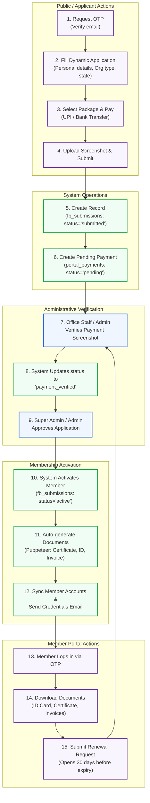

# 📋 FORTI Member Application — Master Onboarding & Handover Guide

Welcome to the **FORTI Member Application** platform! This document is designed to serve as a comprehensive onboarding guide, specifically written for you as the new software owner/developer taking over the project.

It provides a deep, senior-developer-level analysis of the application's architecture, data flows, roles and permissions, codebase structure, and step-by-step real-world instructions on how to use and test the software. Finally, it exposes critical architectural bugs and gaps identified during the system audit.

---

## 🎯 1. System Overview

The **FORTI Member Management System** is a double-sided web portal designed to manage the entire lifecycle of trade association memberships. It consists of:
1. **Public/Member Portal**: Where candidates apply, upload verification details, track their status, download certificates, and submit renewal payments.
2. **Admin Panel**: A restricted back-office dashboard where administrative staff, regional branch managers, and super administrators review applications, verify payments, approve memberships, adjust system settings, manage CMS content, and view reports.

---

## ⚙️ 2. Tech Stack & Infrastructure

The application runs as a decoupled client-server architecture:

*   **Frontend**: Built with **React (Vite)**, styled using **Tailwind CSS**, and utilizing **TanStack React Query** for server-state caching, **React Hook Form** for dynamic multi-step form state, and **Axios** for API requests. It runs on port `3000`.
*   **Backend**: Node.js/Express REST API on port `5001`. It relies on a raw SQL compatibility layer (`sqlCompat.js`) that allows MySQL queries to run on PostgreSQL.
*   **Database**: PostgreSQL 16 running inside Docker, exposed locally on port `5435`.
*   **Core Services**:
    *   **PDF Generation**: Replaced old coordinate-based drawing (`pdfkit`) with a headless **Puppeteer** HTML-to-PDF compiler for pixel-perfect modern branding.
    *   **OTP System**: Powered by an OTP generator that uses a hardcoded bypass (`000000`) in development mode.
    *   **Automated Scheduling**: Managed by `node-cron` running daily at 9:00 AM to process membership renewal notifications and status expirations.

---

## 🔄 3. Membership Lifecycle & Data Flow

Below is the complete workflow diagram representing how a user transitions from a prospect to an active member, and eventually handles renewals.



---

## 🚀 4. Real-World Walkthrough (Using "Abhi" Persona)

To understand how the application functions, let's step through a real-world testing flow simulating a candidate named **Abhi** applying for a membership.

### Step 1: Applicant Submits Application (Abhi)
1. Go to the Landing Page: `http://localhost:3000`
2. Click **Apply Now** to navigate to the dynamic application form: `http://localhost:3000/apply/membership-application`
3. Enter Name (**Abhi**), Email (`abhi@example.com`), and Phone. Click **Send OTP**.
4. **OTP Bypass**: Input `000000` (the development bypass code) and click **Verify**.
5. Fill out the application steps:
   *   **Personal**: Upload a profile photo, gender, and Aadhaar card number.
   *   **Location**: Select Country (India), State (Rajasthan), and City.
   *   **Organization**: Enter Organization Name, select Organization Type, and upload a Logo.
   *   **Package**: The system dynamically matches the pricing rules. Select a package (e.g., *Individual Membership*).
6. **Payment**: Select a payment method (e.g., UPI) and see the instructions dynamically populated (e.g., UPI ID: `forti@upi`). Transfer simulated funds and upload a mock payment screenshot.
7. Click **Submit Application**. Abhi is redirected to `http://localhost:3000/member/status`, which states: *Your application is under review*.

---

### Step 2: Admin Verifies Payment (Office Staff)
1. Log in to the Admin Panel: `http://localhost:3000/login` using **Office Staff** credentials.
   *(Or Super Admin: `admin@forti.org` / `Admin@12345`)*
2. Go to **Applications**. Click on **Abhi's** application.
3. Click the **Payments** tab on the submission detail view.
4. Review the transaction ID and the payment screenshot.
5. Click **Verify Payment**.
   *   *Backend effect:* `portal_payments.status` transitions to `verified`.
   *   *Submission effect:* `fb_submissions.status` transitions to `payment_verified`.

---

### Step 3: Admin Approves Application (Super Admin / Admin)
1. Log in as **Super Admin** (`admin@forti.org` / `Admin@12345`).
2. Navigate to **Applications**, open **Abhi's** detail view.
3. Click **Approve Application** (or **Activate** directly).
   *   *Backend effect:* `fb_submissions.status` becomes `active`, and `fb_submissions.membership_id` is assigned (e.g., `FORTI-177979`).
   *   *Account generation:* An active user record is created or toggled to active in the `member_accounts` table.
   *   *Background job:* Puppeteer renders and saves the Certificate PDF, ID Card PDF, and Invoice PDF inside the backend's `/storage` directory.
   *   *Email Notification:* An email containing the member ID and login instructions is sent to `abhi@example.com`.

---

### Step 4: Member Accesses Portal (Abhi)
1. Navigate to Member Login: `http://localhost:3000/member/login`
2. Enter `abhi@example.com`. Request OTP, and input bypass code `000000`.
3. Abhi is logged in and redirected to `http://localhost:3000/member/dashboard` (the Member Dashboard).
4. Abhi can now:
   *   See the welcome card and active status badge.
   *   Go to **My Documents** and click **Download PDF** for Certificate, ID Card, and Invoices.
   *   Go to **Renew Membership** (available only if within 30 days of expiration).

---

## 🛡️ 5. Role-Based Access Control (RBAC) Matrix

The system enforces 4 admin roles. Here is the matrix of what each role can access:

| Feature / Tab | Super Admin | Admin | Branch Manager | Office Staff | Scoping Details |
| :--- | :---: | :---: | :---: | :---: | :--- |
| **Dashboard / Metrics** | ✅ Full | ✅ Full | ✅ Regional | ✅ Regional | Scoped to assigned state ID for Manager/Staff |
| **Applications (Read)** | ✅ | ✅ | ✅ | ✅ | Scoped to state ID for Manager/Staff |
| **Verify Payment** | ✅ | ✅ | ❌ | ✅ | Only Office Staff & Admins can click "Verify" |
| **Approve / Reject Application** | ✅ | ✅ | ✅ | ❌ | Office Staff cannot approve or reject |
| **Members List** | ✅ | ✅ | ✅ | ✅ | Scoped to state ID for Manager/Staff |
| **Renewals Hub** | ✅ | ✅ | ✅ | ❌ | Hidden on frontend from Office Staff |
| **Verify Renewals** | ✅ | ✅ | ❌ | ❌ | Restricted by ghost role bug |
| **Packages / Plans Configuration**| ✅ | ✅ | ❌ | ❌ | Branch Manager & Staff cannot modify pricing |
| **Audit Logs** | ✅ | ❌ | ❌ | ❌ | Restrictive to Super Admin only |
| **Users (Staff Management)** | ✅ | ❌ | ❌ | ❌ | Only Super Admin can manage staff |
| **System Settings** | ✅ | ❌ | ❌ | ❌ | Only Super Admin can modify SMTP/templates |

---

## 📁 6. Codebase Map

Here are the most critical files you need to interact with as you manage and expand the platform:

### Backend Files (`/backend`)
*   [app.js](file:///Users/manoj/Desktop/FORTI/forti-member-app/backend/src/app.js): Express entry point, startup migrations, and daily cron trigger.
*   [config/database.js](file:///Users/manoj/Desktop/FORTI/forti-member-app/backend/src/config/database.js): Database connection pooling.
*   [config/sqlCompat.js](file:///Users/manoj/Desktop/FORTI/forti-member-app/backend/src/config/sqlCompat.js): **Critical compatibility layer.** Translates standard MySQL-style queries (e.g., using `?` placeholders) into PostgreSQL syntax at runtime.
*   [routes/membership.js](file:///Users/manoj/Desktop/FORTI/forti-member-app/backend/src/routes/membership.js): Handles applicant routes (Dynamic package match & `/apply`).
*   [routes/submissions.js](file:///Users/manoj/Desktop/FORTI/forti-member-app/backend/src/routes/submissions.js): Admin and public API for managing submissions.
*   [routes/approvals.js](file:///Users/manoj/Desktop/FORTI/forti-member-app/backend/src/routes/approvals.js): State transitions (Review -> Verify -> Activate) and document generation.
*   [routes/renewals.js](file:///Users/manoj/Desktop/FORTI/forti-member-app/backend/src/routes/renewals.js): Renewal submission and processing.
*   [utils/pdfGenerator.js](file:///Users/manoj/Desktop/FORTI/forti-member-app/backend/src/utils/pdfGenerator.js): Puppeteer browser setup, styling, and templates for certificate, ID card, and invoice PDFs.
*   [utils/email.js](file:///Users/manoj/Desktop/FORTI/forti-member-app/backend/src/utils/email.js): Nodemailer templates for emails.

### Frontend Files (`/frontend/src`)
*   [App.jsx](file:///Users/manoj/Desktop/FORTI/forti-member-app/frontend/src/App.jsx): Routing hub and permission guards (`RoleRoute`, `MemberRoute`).
*   [layouts/AdminLayout.jsx](file:///Users/manoj/Desktop/FORTI/forti-member-app/frontend/src/layouts/AdminLayout.jsx): Sidebar layout displaying tabs based on logged-in user role.
*   [contexts/AuthContext.jsx](file:///Users/manoj/Desktop/FORTI/forti-member-app/frontend/src/contexts/AuthContext.jsx): Admin session management.
*   [contexts/MemberContext.jsx](file:///Users/manoj/Desktop/FORTI/forti-member-app/frontend/src/contexts/MemberContext.jsx): Member login and profile state.
*   [pages/admin/applications/ApplicationView.jsx](file:///Users/manoj/Desktop/FORTI/forti-member-app/frontend/src/pages/admin/applications/ApplicationView.jsx): Detail view of submissions showing step actions.
*   [pages/member/MemberDashboard.jsx](file:///Users/manoj/Desktop/FORTI/forti-member-app/frontend/src/pages/member/MemberDashboard.jsx): The profile, document download, and renewal UI for members.

---

## 🚨 7. Senior Developer Audit: Major Bugs & Broken Functions

During a deep audit of the codebase, several major structural bugs and functional gaps were discovered. You must be aware of these as they directly break normal business workflows:

### 1. The Branch Manager Visibility Bug (`state_id` column missing)
*   **The Issue**: When a candidate applies via `/api/membership/apply`, all their location choices (State ID, City ID, etc.) are bundled and saved as a JSON string inside the `data` column of `fb_submissions`. However, the code **fails** to write the `state_id`, `city_id`, or `country_id` to their designated columns in the `fb_submissions` database table (they remain `NULL`).
*   **The Bug**: Branch Managers are scoped by state. When a Branch Manager retrieves applications, the API filters submissions via:
    ```sql
    SELECT * FROM fb_submissions s WHERE s.state_id = ?
    ```
    Since new applications have a `NULL` state_id column, **Branch Managers will see 0 applications** in their dashboard, even if many candidates have applied from their state.
*   **Status**: *Broken in code*. Needs database-column mapping added to `/api/membership/apply` insert parameters.

### 2. The "Accountant" Ghost Role Bug in Renewals
*   **The Issue**: In `backend/src/routes/renewals.js`, the verification route is locked via:
    ```javascript
    router.patch('/:id/verify', requireRole('super_admin', 'admin', 'accountant'), ...)
    ```
    However, **"accountant" is not a real role** in the database schema or frontend layouts. The intended regional role that processes payment records is `office_staff`.
*   **The Bug**: Because of this ghost role check, regional `office_staff` cannot verify renewal payments (getting a 403 Forbidden error). Renewals are bottlenecked at the Super Admin/Admin level. Furthermore, the Renewals tab is completely hidden from `office_staff` on the frontend (`AdminLayout.jsx`).
*   **Status**: *Broken in code*.

### 3. Lack of Duplicate Submission Constraints
*   **The Issue**: The database schema and route handlers do not check if a candidate has already applied. The `fb_submissions` table does not have a `UNIQUE` constraint on `applicant_email` or `applicant_phone`.
*   **The Bug**: A candidate can submit the application form multiple times, creating duplicate pending accounts, duplicate invoices, and causing major confusion for reviewers.
*   **Status**: *Structural Gap*.

### 4. Branch Manager Payment Blindspot
*   **The Issue**: Branch Managers have access to renewals, applications, and members, but have **no read access to the Payments tab** on the frontend (`AdminLayout.jsx`).
*   **The Bug**: If a member hands a payment receipt or UPI transaction details to a Branch Manager, the Manager cannot view the transaction or check if the payment is verified. They must rely on Office Staff or Admins, hindering branch operations.
*   **Status**: *Workflow Gap*.

### 5. Development Bypass Security Warning
*   **The Issue**: The OTP verification endpoint accepts `000000` as a universal bypass for login and application.
*   **The Bug**: While useful for testing, this bypass is **not** gated behind an environment check (like `process.env.NODE_ENV !== 'production'`). If this code is deployed to production, anyone can log in as any member by entering their email and `000000`.
*   **Status**: *Security vulnerability*.

### 6. The "Lifetime Membership" Auto-Verification & Auto-Activation Bug
*   **The Issue**: In `backend/src/routes/membership.js`, there is a hardcoded rule that intercepts submissions and says:
    ```javascript
    // ── Lifetime plan: auto-verify payment and activate immediately ──
    if (plan_type === 'lifetime') { ... }
    ```
*   **The Bug**: When a user selects a plan of type `lifetime` (e.g., Satveer choosing "Lifetime Membership"), the system immediately marks the payment as `verified` and changes the submission status to `active` upon submission. It completely bypasses all admin approval checks and payment receipt verification steps.
*   **Business Risk**: High. Anyone can apply for a Lifetime Membership, upload a blank file or fake payment receipt, and instantly receive active portal access, print a valid certificate, and download an official ID card without paying a single Rupee.
*   **Status**: *Glitch / Business logic logic flaw*.

### 7. Daily Expiry & Reminder Cron Crash (PostgreSQL Syntax Error)
*   **The Issue**: The daily reminder script `backend/src/cron/renewalReminders.js` (running at 9:00 AM) runs a parameterized SQL query containing:
    ```sql
    DATE(s.expiry_date) = DATE_ADD(CURDATE(), INTERVAL ? DAY)
    ```
*   **The Bug**: While this is valid MySQL syntax, the database is running on **PostgreSQL**. In PostgreSQL, parameter placeholders (e.g., `$1`) are **syntactically forbidden** inside `INTERVAL` literals (e.g., `INTERVAL $1 DAY`), throwing a `42601 syntax error`.
*   **Impact**: The daily cron job crashes every single morning at 9:00 AM. It **never** sends renewal reminder emails and **never** marks expired memberships as `'expired'`.
*   **Solution**: The SQL query must be rewritten using standard PostgreSQL parameters, for example: `CURRENT_DATE + (? * INTERVAL '1 day')`.
*   **Status**: *Critically broken on PostgreSQL*.

---


## 🛠️ 8. How to Spin Up the System & Test

To run the application locally, use the following commands:

1.  **Start PostgreSQL DB Container**:
    ```bash
    docker compose up -d
    ```
2.  **Start API Backend**:
    ```bash
    cd backend
    npm run dev   # runs using nodemon for live-reload
    ```
3.  **Start React Frontend**:
    ```bash
    cd frontend
    npm run dev   # launches Vite dev server on port 3000
    ```
4.  **Run Automated QA Test Suite**:
    The codebase includes an automated API integration test runner `qa_suite.js` containing 24 tests that validate the entire lifecycle. Run it with:
    ```bash
    cd backend
    node qa_suite.js
    ```

---

## 💡 9. Recommended Next Action Steps

As you assume control of the codebase, here are the recommended changes you should schedule for the next update phase:

1.  **Patch the Application Submission SQL**: Update `/api/membership/apply` to insert `state_id`, `city_id`, and `country_id` directly into the database columns of `fb_submissions`. This immediately restores visibility for Branch Managers.
2.  **Fix the Renewals Role**: Replace `accountant` with `office_staff` in `backend/src/routes/renewals.js` and add `Renewals` to the office staff navigation array in `AdminLayout.jsx`.
3.  **Apply Environment Guards to OTP**: Gate the `000000` master bypass inside `backend/src/routes/otp.js` so it only works if `process.env.NODE_ENV` is set to `development` or `test`.
4.  **Incorporate Email & Phone Unique Checks**: Add verification queries to reject new application requests if a record with the same email already exists and is active.
5.  **Expose Read-Only Payments to Branch Managers**: Update `AdminLayout.jsx` to let Branch Managers view the Payments tab for scoping region tracking.
6.  **Rewrite daily cron date queries**: Update `backend/src/cron/renewalReminders.js` to replace MySQL's `DATE_ADD()` interval query with PostgreSQL's `CURRENT_DATE + (? * INTERVAL '1 day')` query syntax to prevent daily crashes.

